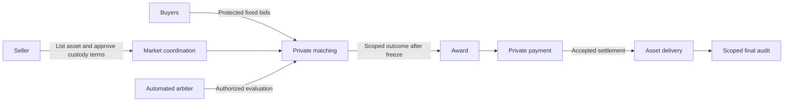

# Concept

## A private market for digital assets

Void Market lets a seller offer a digital asset and lets buyers compete without exposing their prices to one another. The market determines the highest eligible bid through operations on encrypted values. It reveals the authorized outcome when bidding is fixed, rather than publishing a running leaderboard.

The intended result is simple: an asset changes hands, the seller and winning buyer know the sale price, and the market has evidence for the decisions it accepted without ordinarily learning the underlying amounts.

This is a product design, not a claim that every cryptographic and settlement component is already implemented or proven secure. Its defining objective is **private matching**. The first demonstration separates that objective from the harder problem of making payment and asset transfer atomic across different networks.

## Who participates

| Participant | Responsibility | Information needed |
| --- | --- | --- |
| Seller | Lists an asset, sets a private minimum acceptable price, consents to the assigned service’s custody terms, and acknowledges payment | Own reserve, winning price, and incoming payment information |
| Buyer | Commits a private bid, participates in authorized checks, and pays if awarded the asset | Own bid and requests relevant to that buyer |
| Automated arbiter | Program that executes specified rules, evaluates allowed comparisons, coordinates the outcome, and manages the asset during the sale | Protected inputs, authorized comparison outcomes, and scoped settlement evidence |
| Market platform | Presents listings and requests, coordinates participants, and records progress | Workflow information and the authorized outcome, not ordinary bid plaintext |
| Authorized verifier | Checks a specific proof or dispute within an agreed disclosure scope | Only the evidence required for that check |

The automated arbiter is our platform-owned separate service, with a distinct execution responsibility from the market backend. It registers internally and claims eligible listing work. The seller explicitly accepts the asset-custody and transfer terms before handing over the asset; this is not a marketplace of competing external arbiters. Service separation does not itself establish protocol privacy.

## What the auction means

The selected sale rule is **pay your bid**: the winner pays the price they submitted. A buyer is eligible when their bid meets or exceeds the seller's minimum. The highest eligible bid wins; equal bids are resolved by the earliest immutable admission order.

The accepted bids and comparison policy become fixed before any comparison outcome is released. Participants cannot submit a new price after seeing who was ahead. If an existing participant is excluded under the agreed refusal policy, the remaining participants are reconsidered using their original frozen bids, not a new round of price discovery.

A bid is an offer. It is not a wallet balance, proof of available funds, or reservation of money. Payment is a later stage with its own evidence and deadline.

## What remains private

The design separates three kinds of information:

- **Numeric values:** bids, reserve, and ordinary sale amounts are not published. Masks used to protect numeric transfers are not opened in the final audit.
- **Comparison outcomes:** a statement such as “this bid exceeds that bid” is released only after the bidding freeze and only to authorized recipients. The full ranking is not automatically public.
- **Workflow facts:** listing status, requests, the selected winner, and delivery status can be visible as needed without exposing every comparison or amount.

Price privacy is not universal anonymity. A public asset network can expose the asset identifier, addresses, transfer events, and timing. Payment disputes may require disclosure of the amount and recipient of one relevant payment output to an authorized reviewer. That scoped exception does not authorize disclosure of a wallet's full balance or unrelated transactions.

## How the pieces fit together

In words: the market coordinates participation; the arbiter evaluates the permitted matching operations; the winner pays; and asset delivery follows accepted settlement. The final audit checks the authorized record without opening the numeric bid masks.

The conceptual boundaries are equally important. A mathematics component handles operations over protected and public values. A private-operation component coordinates the participants, commitments, masks, and proof requirements. Market rules decide eligibility and sale progression. Payment and asset adapters connect those rules to their respective networks. None of these responsibilities should silently substitute for another: a message receipt is not a payment proof, and a signature on a result is not proof that the encrypted calculation was correct.

## Demonstration scope

The initial experience is deliberately focused: one seller, one asset, a small set of buyers, and the assigned automated arbiter service with seller-approved custody terms. An external NFT on Ethereum Sepolia illustrates the asset side; Zcash testnet illustrates the private payment side. The asset is not a native Zcash NFT.

The arbiter receives confirmed control of the asset before the sale proceeds. After accepted payment, it transfers the asset to the winner; if the sale is safely canceled, it returns the asset to the seller. The platform coordinates these steps and their recovery conditions.

**The full exchange is not atomic.** An individual asset transfer can be one transaction, but the payment and asset delivery are separate actions on separate networks. Custody, availability, and dispute handling therefore remain meaningful dependencies. This is an explicit boundary of the first demonstration, not something encryption eliminates.

## What a successful demonstration establishes

A useful demonstration shows that participants can follow the complete intended journey, that unauthorized or incomplete operations do not become accepted results, and that normal matching does not require publishing prices. It distinguishes actual verified evidence from simulated workflow examples.

Successful demonstration of a workflow does not establish production security or cross-chain atomic settlement.

Continue with [the full lifecycle](how-it-works.md), [the masking and proof model](cryptographic-protocol.md), or [the reasons behind the design](design-decisions.md).

The arbiter is an automated program, not a discretionary human decision-maker. The platform remains accountable for the service and custody duties; automation does not itself certify correct or private execution.

## Protocol and privacy

At this stage of protocol development, we cannot yet guarantee complete privacy. Further research and protocol improvements are planned to strengthen its privacy guarantees.
