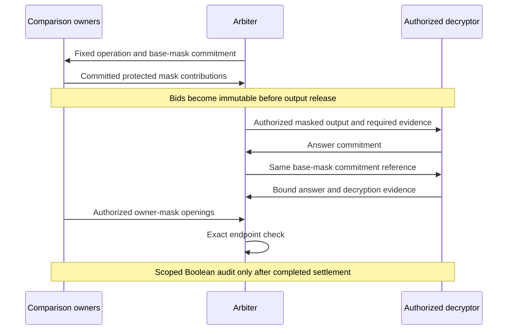
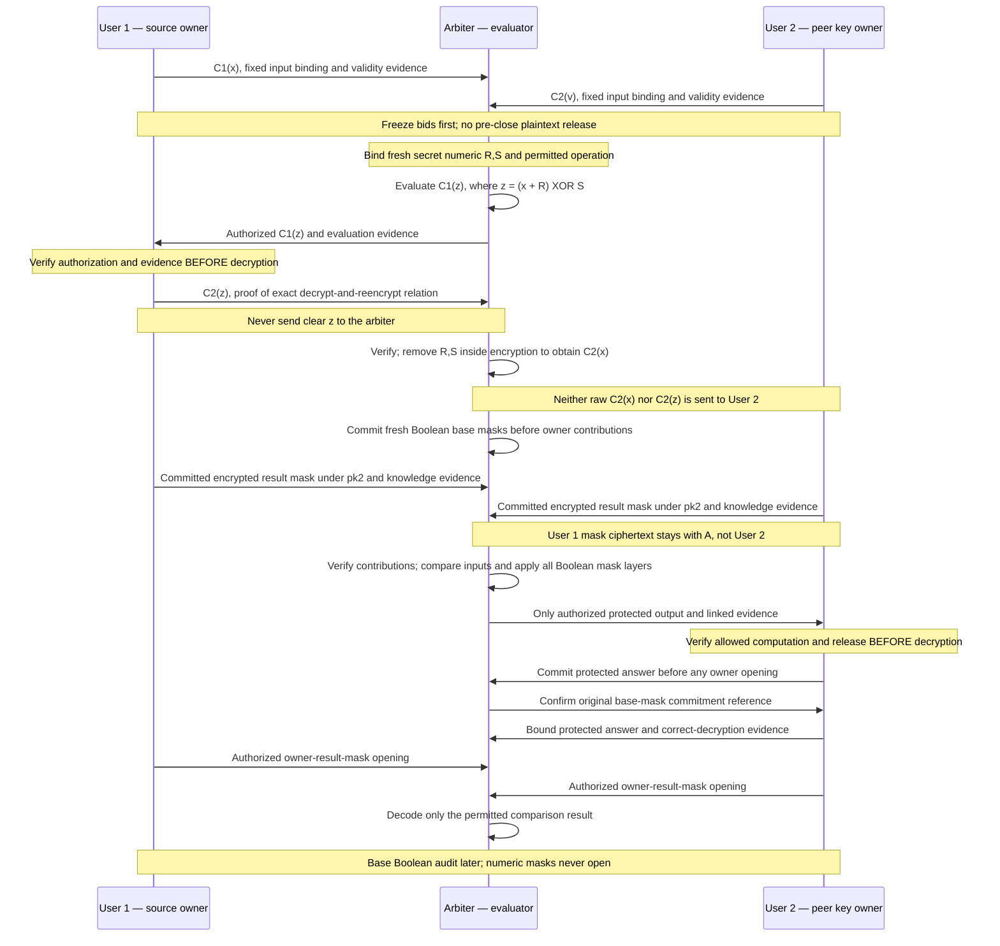

# Cryptographic protocol

For a plain-language introduction, read the [plain-language explanation](protocol-explained.md), especially [how the pieces fit together](protocol-explained.md#6-how-the-pieces-fit-together).

The protocol separates three jobs: hide values, bind participants to their chosen inputs, and verify that an accepted result came from the allowed computation. No single mask, hash, or signature performs all three jobs.

This document explains the selected mathematical design and its verification requirements. The masking identities below are precise; they are not a claim that the entire interactive protocol has already been implemented or proven secure against malicious participants.

## Values, widths, and exact arithmetic

A width of $w$ means an unsigned value represented by $w$ bits. The selected mode determines $w$ for the auction; the protocol is not fixed to 64 bits. Every formula below uses that selected width. The symbol $\oplus$ denotes bitwise XOR throughout this document.

| Mode | Width $w$ | Status |
| --- | --- | --- |
| LIVE | 64 | Target profile, not a production-security certification |
| DEMO | 32 | Demonstration profile |
| DEBUG | 16 | Debugging profile |
| TEST | 8 | Testing profile |
| HARD | 128 | Theoretical future profile; disabled |

Define:

$$
L = 2^{w-1}-1.
$$

Numeric inputs and their additive masks use at most $w-1$ bits, leaving room for the selected addition within a $w$-bit result. The input range check is $X \leq L$, equivalently $X < 2^{w-1}$. **Illustrative LIVE example ($w=64$):** the maximum permitted input is $2^{63}-1$, not $2^{63}$; the check is $X \leq 2^{63}-1$, equivalently $X < 2^{63}$.

All additions below are exact checked integer additions. They are not silent modular wraparound. XOR is a bitwise operation, not ordinary addition or a substitute for addition in a proof field. The chosen mode, width, and allowed ranges are fixed for the auction before inputs are admitted; runtime operations must not silently switch profiles, truncate a price, or downgrade its profile.

## Numeric masking: hide the original number

For a numeric value, the selected transformation is:

$$
N=(X+R)\oplus S,
$$

where $X,R \in [0,L]$ and $S \in [0,2^w-1]$. The mask values are fresh and independently sampled for this operation. In particular, $S$ is uniform over the complete width, including zero.

The largest sum is $2L=2^w-2$, which fits in $w$ bits. To reverse the transformation, first compute $Z=N\oplus S$, require $Z\geq R$, then subtract $R$ and check the permitted range of the recovered $X$.

For a fixed sum and an independent uniform secret XOR mask, every output word is equally likely. An output accidentally equaling the original value does not identify that event to an observer. A zero mask is not excluded simply because it is zero; the relevant property is the sampling distribution and secrecy of the mask, not whether a particular sample looks random.

This is a **hiding transformation**, not an authenticity mechanism. The extra random offset does not turn a valid-looking answer into proof that a client decrypted honestly.

Numeric masks are not opened in the final audit. A numeric transfer that requires them must complete its required evidence and protected processing before they are erased. Losing necessary ephemeral information aborts that attempt; it does not authorize guessing a result or revealing an original bid to recover it. An honest implementation can avoid retaining masks, but a deletion rule cannot prove that a malicious party forgot them.

## Boolean masking: encode two distinct outcomes

For a comparison result $B\in\{0,1\}$, the selected transformation is:

$$
E=(B R_1+R_2)\oplus S.
$$

For the selected width $w$, **$R_1$ and $R_2$ use $w-1$ bits, while $S$ and the encoded output use $w$ bits**:

- $R_1$ is uniform over $[1,L]$; it must be nonzero.
- $R_2$ is uniform over $[0,L]$.
- $S$ is uniform over all $w$-bit words.
- The samples are fresh and independent for each operation and attempt.

**Illustrative LIVE example ($w=64$):** $R_1$ and $R_2$ use 63 bits, and $S$ and the output use 64 bits. DEMO, DEBUG, and TEST apply the same rule at their selected widths; this example does not fix the protocol to 64 bits.

Before XOR, the two possible codewords are $C_0=R_2$ and $C_1=R_2+R_1$. The largest possible value is again $2^w-2$, so the selected addition does not overflow. A larger pre-XOR value can reveal information about the bit; the full-width secret XOR mask hides that distinction from an observer who does not know the mask.

The multiplier separates the two valid codewords; the offset relocates them; XOR hides their position. Multiplying a Boolean by a value can conceptually be expressed as choosing between the two endpoints. Any such optimization must preserve the same committed operation and proof requirements, not let an evaluator select unrelated labels.

### Exact decoding

Compute $Z=E\oplus S$ and accept only:

| Recovered value | Result |
| --- | --- |
| $Z=R_2$ | False |
| $Z=R_2+R_1$ | True |
| Any other value | Invalid |

There is no rounded division, approximate tolerance, or rule that a missing response means false. Nonzero $R_1$ ensures that the two accepted values are distinct.

### What the isolated guessing bound does—and does not—say

The following is an idealized, single-response mathematical model with one observed valid masked codeword and no other information about the independent uniform masks. The difference that flips the two endpoints is:

$$
\Delta=R_2\oplus (R_2+R_1).
$$

For the stated domains, this difference is uniform over the $w$-bit words except zero and $2^{w-1}$. Guessing the other endpoint through a permitted nonzero XOR difference therefore succeeds with probability $1/(2^w-2)$ in this isolated model.

This narrow statement is **not a whole-protocol security level**. It does not establish correct evaluation, correct decryption or privacy of the complete interaction. A bit-width label cannot replace the required construction and verification of the full protocol.

The older encoding $(B+R)\oplus S$ is not the selected Boolean formula. Its adjacent endpoints do not provide the same isolated guessing behavior.

## Owner masks and the two disclosure gates

The arbiter knows its own Boolean masks. They therefore cannot, on their own, hide the result from that arbiter. Each comparison owner contributes a separate independent full-width output mask, here called $r_a$ and $r_b$ to distinguish them from $R_1$ and $R_2$:

$$
Y=E\oplus r_a\oplus r_b.
$$

Each owner commits to their mask before it is used. A commitment fixes a value while keeping it hidden until an authorized opening; the proof requirements must also bind that commitment to the mask used in the encrypted computation. Merely hashing an arbitrary answer does not prove that it was computed correctly.

Two disclosure gates have different purposes:

1. **After immutable bidding freeze:** owners can open their output masks to the authorized recipient so the comparison can be interpreted and the winner selected.
2. **After accepted payment and completion of the required operations:** the arbiter's Boolean encoding masks can be opened for a scoped final audit.

Putting both openings after payment would be circular: the system needs a winner before it can request the winner's payment. Conversely, opening everything as soon as bidding ends would expose more than winner selection requires.

Numeric masks are a different category and are never included in those audit openings. Neither are secret wallet keys or unrelated values. An observer who receives an output and every mask needed to decode it learns the result; a label saying “private” does not change that fact.

## One comparison from inputs to result

The following sequence describes a buyer-pair comparison. The same protection pattern can support a separately authorized reserve check, but it must use that check's fixed predicate and context.

1. **Fix the inputs and purpose.** Bind the exact admitted encrypted bids, their owners, order, width, encryption context, comparison rule, and disclosure scope. For a buyer pair, compare the later-admitted bid against the earlier one using strict “greater than,” so equality preserves the earlier bid's priority.
2. **Fix the arbiter's base masks.** The arbiter commits to its fresh Boolean masking parameters before receiving the owners' contributions and before any answer. It cannot adapt those parameters after seeing a response.
3. **Collect owner contributions.** Each owner commits to a fresh output mask and provides its encrypted contribution with evidence of knowledge and consistency. An unchecked copied ciphertext is not an acceptable substitute for a known mask.
4. **Compute only the authorized protected output.** The evaluator performs the fixed comparison, Boolean encoding, and outer masking on encrypted data. It does not request an arbitrary raw bid or an adaptive threshold answer.
5. **Check the release gate before decryption.** Immutable freeze and membership evidence must authorize this exact output. Required evaluation and output-privacy evidence must verify before the decryptor acts. Before freeze, the selected demonstration permits encrypted preparation only.
6. **Fix the returned answer.** The decryptor commits to the masked answer before the later openings. The arbiter repeats its existing base-mask commitment rather than choosing a new one. The returned value must match the answer commitment and carry the required correct-decryption evidence.
7. **Open the owners' output masks.** Only after the gate and fixed answer do the owners reveal the masks to the permitted recipient. The recipient checks each opening against its original commitment.
8. **Decode exactly.** Remove the outer masks and apply the two-endpoint Boolean check. An invalid or missing value remains unresolved. A valid result is released only within its authorized scope.
9. **Audit later.** After payment and completion, the scoped audit verifies the Boolean masking relationship and accepted record. It does not retroactively authorize an early leak or turn an unverified computation into a verified one.

The sequence is not a trust-by-message-count scheme. Each evidence check has to establish its own claim; signed messages alone cannot fill a missing cryptographic proof.

## What must be proved

The required evidence connects the whole operation rather than checking disconnected pieces:

- **Input validity and range:** the admitted encrypted value is well formed and within the allowed domain.
- **Mask knowledge and binding:** a contributed mask is known to its owner and matches both its commitment and encrypted use.
- **Authorized evaluation:** the returned ciphertext is the output of the permitted circuit over the exact fixed inputs and masks.
- **Correct decryption:** the returned plaintext corresponds to that exact authorized ciphertext and the registered key.
- **Output privacy:** the released ciphertext and accompanying evidence do not expose extra input information through their representation or transcript.
- **Release authorization:** the relevant freeze, membership, operation, and recipient scope permit this release now.

A hash binds bytes. A signature identifies an approving key. A range check restricts a value. None of them alone proves that a Boolean answer is the true result of the authorized comparison. If a required proof or verifier is unavailable, the strong verification path stops. A simulated demonstration may illustrate the workflow, but it must not manufacture a verified receipt.

## Key topology and privacy scope

At this stage of protocol development, we cannot yet guarantee complete privacy. Further research and protocol improvements are planned to strengthen its privacy guarantees.

The design requires that participants must not receive foreign bids encrypted under their personal keys. The final matching key construction remains open. Owner-result masks remain part of the intended mechanism, and protected outputs require the specified authorization and verification gates. Earlier common-key and cross-key blueprints are not presented as completed or accepted safe solutions; no threshold or other replacement construction is adopted here.

The selected payment-dispute design is separate: it compares the buyer's own bid under that buyer's own key, as described in [How it works](how-it-works.md#8-confirm-payment-or-resolve-a-scoped-dispute). Acceptance of that intended behavior does not establish availability of its proof implementation.

## Candidate peer exchange through the arbiter

This is a **retained multi-key candidate, not an adopted safe design or enabled capability**. It explains the requested user-to-user path through an arbiter. It does not resolve or replace the open matching construction described above. Transferring a secret into another key domain for protected computation is **not** permission to reveal its plaintext to that key owner.

User 1 owns input $x$ and secret key $sk_1$; User 2 owns input $v$ and secret key $sk_2$. The arbiter holds neither secret key. Here $C_1(t)$ means an encryption of $t$ under User 1's public key; $C_2(t)$ means an encryption under User 2's public key. Width $w$ and the permitted comparison are fixed by the auction profile before admission.

The numeric return must prove that **the exact value decrypted from the authorized request is the value re-encrypted under the peer's public key**. A signature, hash, or in-range number does not establish that relation. The arbiter removes numeric masks only inside encrypted computation. The access requirements prohibit clear $z$ at the arbiter and prohibit raw $C_2(x)$ or $C_2(z)$ at User 2. This retained candidate does not satisfy the no-foreign-key design requirement as an adopted solution and remains disabled.

The final output uses the selected Boolean encoding and separate owner-result masks. Each owner contributes a commitment and a matching encryption under the destination public key, with knowledge and binding evidence. User 1's raw mask ciphertext remains outside User 2's authorized access; the required evidence must prove the linkage without disclosing it. The arbiter commits its Boolean base masks before collecting those owner contributions, and the decryptor commits the protected answer before owner openings. Owner openings follow the post-freeze winner-selection gate; base Boolean audit openings follow accepted payment and completed operations. Numeric-transfer masks remain secret, including during audit. The evidence must link every conversion, mask layer, comparison, and returned answer without exposing those numeric witnesses; see [What must be proved](#what-must-be-proved) and [Owner masks and the two disclosure gates](#owner-masks-and-the-two-disclosure-gates).

For this candidate, the first decryption/conversion request is also **post-freeze** under the current no-pre-close-plaintext policy. An earlier release would require a separately authorized changed profile, not an interpretation of this diagram. The necessary proof construction and backend support remain unresolved, so the conversion stays disabled.

Read [How it works](how-it-works.md) for settlement timing and [Design decisions](design-decisions.md) for the rationale behind these boundaries.

The term **automated arbiter** means that a program executes the specified protocol rules. It does not by itself establish verified execution or secrecy; the proof, key-topology and disclosure qualifications above still apply.
