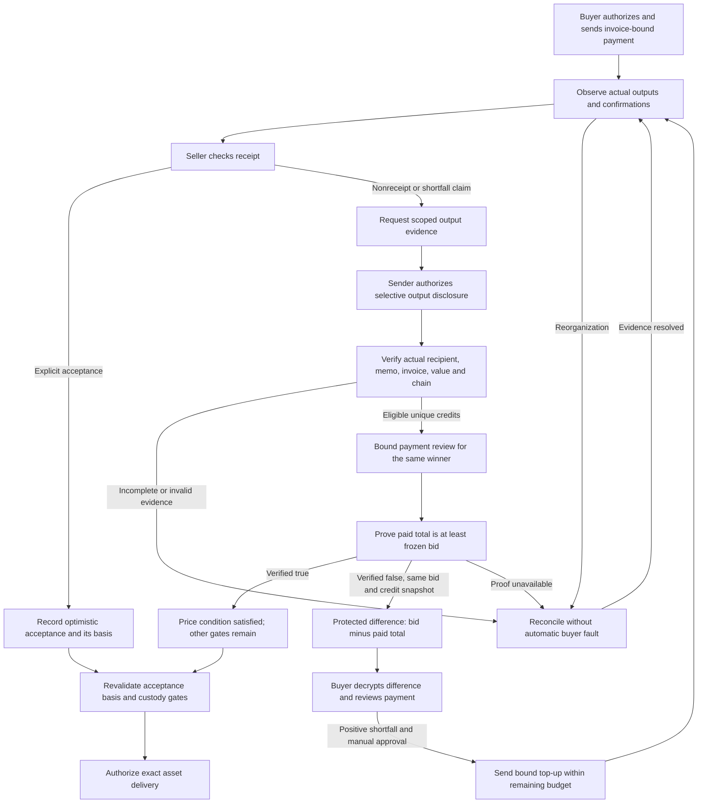
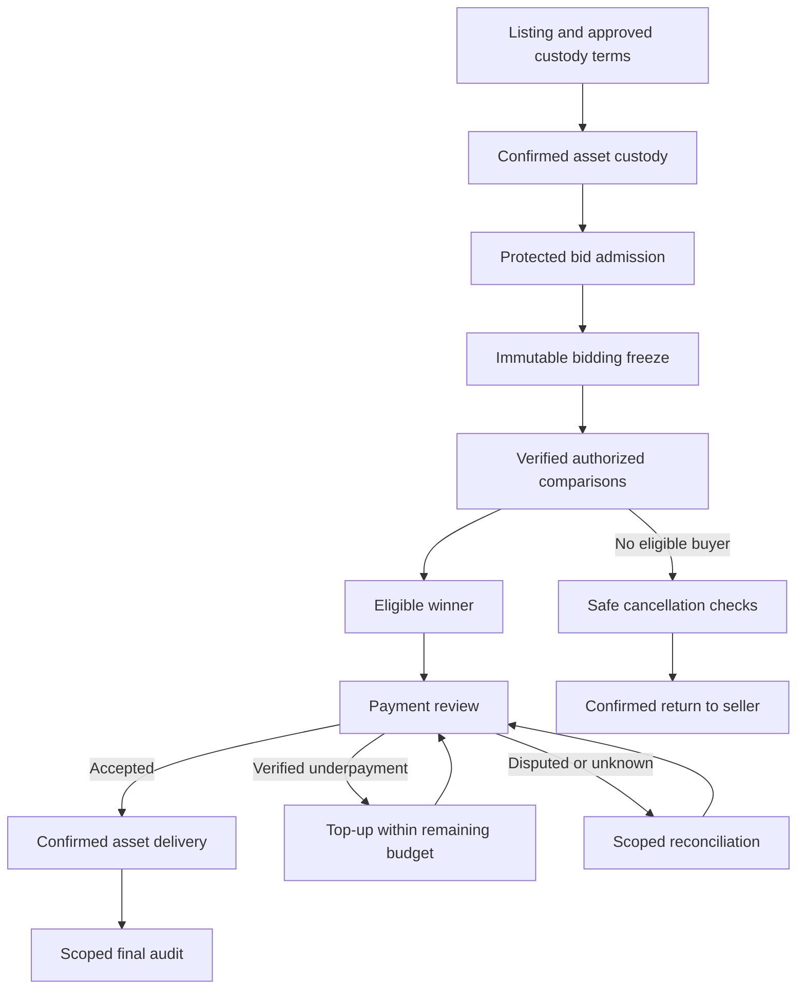

# How it works

This document follows one asset sale from listing to completion. It describes intended behavior and the evidence required to advance each stage. A request being delivered, signed, or displayed is not by itself evidence that its underlying claim is true.

## 1. Create a listing and approve custody terms

The seller identifies the asset and chooses a private minimum price. The listing fixes the auction rules: accepted value range, bidding deadline, tie-breaking order, allowed comparisons, disclosure policy, and participant response budgets.

The automated arbiter is a platform-owned separate internal service. It registers through the authenticated internal node interface and claims eligible listing work under the market's assignment rules. The seller sees the assigned service's responsibility, permitted custody scope and applicable terms, rather than choosing among competing external operators. Arbiter collateral is not required.

The seller explicitly approves or declines the custody and asset-transfer terms. Declining them does not authorize an asset deposit. One service can handle several sales, but each sale retains a versioned assignment and exact custody authority. Redistributing internal work must not silently change that authority or the approved transfer destination.

## 2. Establish confirmed asset custody

The asset identity and destination for custody are fixed before the seller transfers it. In the demonstration direction, the asset is an NFT on Ethereum Sepolia and the custodian is the assigned platform arbiter service under the approved custody terms.

The sale proceeds only after the relevant transfer has been confirmed and control of the exact asset has been checked. A submitted transaction identifier or a promise to transfer is not enough. Merely giving an approval also must not be confused with a completed transfer of custody.

This custody model gives the arbiter real responsibility. It is not automatically a trustless escrow. The market records the custody state and must prevent conflicting instructions to release and return the same asset.

## 3. Admit protected bids

Each buyer submits an encrypted bid tied to their participation in this auction. The seller's private reserve is bound to the sale in the same spirit. The system checks that the value belongs to the permitted range without accepting an unverified plaintext assertion as a substitute.

Admission fixes the exact encrypted input and its context. Replacing the ciphertext, encryption key, or value after admission is not an invisible edit to the same bid. The relevant checks must apply to the exact input later used for matching.

The comparison schedule follows the agreed policy. It does not allow an arbiter to invent successive thresholds to probe a bid. A single pairwise answer is also not sufficient to claim that somebody is the global winner.

## 4. Handle requests asynchronously

Participants receive scoped requests that explain what they are being asked to approve, sign, or reveal. They can confirm or reject each relevant action. Independent comparisons can progress concurrently; a participant is not required to remain on one continuously connected screen.

The market records requests, responses, and state transitions. Re-delivery of a message must not create a second approval, payment credit, or asset transfer. The authoritative workflow distinguishes pending, accepted, invalid, expired, and unresolved states.

Response budgets are attributable to the party whose action is actually required. Waiting for a valid action from the market or arbiter does not consume a buyer's personal response time. Retries do not create unlimited fresh budgets. An invalid request or unavailable proof checker is not treated as a buyer refusing a valid obligation.

## 5. Prepare comparisons without revealing their answers

For a pair of buyers, the arbiter evaluates the allowed comparison over their encrypted bids. It encodes the Boolean result into a protected number. Each participating owner contributes an additional independent mask, committed before use.

Owner-result masks, required verification evidence and the intended key boundaries are designed to keep comparison results private until the authorized release. These masks are distinct from those protecting numeric transfers. The design requirement remains that participants must not receive other participants' bids encrypted under their personal keys; the final matching construction and its proof gates remain open. At this stage of protocol development, we cannot yet guarantee complete privacy. Further research and protocol improvements are planned to strengthen its privacy guarantees. The [cryptographic protocol](cryptographic-protocol.md#one-comparison-from-inputs-to-result) explains the sequence and proof requirements.

In the selected demonstration policy, work before bidding closes is encrypted preparation only. No plaintext-derived answer is released before the freeze. This restriction remains in force even if a later implementation adds more proof capabilities.

## 6. Freeze bidding and release authorized results

The freeze fixes the accepted input set, ordering, policy, and relevant comparison schedule. A participant cannot revise a bid after learning a result. Reserve comparisons in the proposed demonstration run after this freeze.

Before any protected output is decrypted, the required evidence must show that it is the permitted output of the permitted operation. Correct decryption also needs its own evidence. If those gates cannot be satisfied, the operation is unresolved; the system does not label it verified or turn an absent answer into false.

After the authorized masked answer is fixed, the comparison owners open their output masks to the permitted recipient. The arbiter checks those openings and decodes the Boolean result. This opening enables winner selection; it is not the later final audit.

An attributable refusal can lead to policy-defined exclusion. The remaining candidate set is reconsidered using the frozen bids and the required remaining comparisons. There is no new bidding opportunity and no assumption that the excluded participant lost each unfinished comparison.

## 7. Determine the winner and issue the payment request

The market accepts a winner only from a complete, consistent set of required results. The bid must meet the seller's reserve, be highest among the eligible remaining bids, and satisfy the fixed tie rule.

The winner pays their own bid. The seller and winner learn the payment terms necessary to settle the sale. Other participants do not automatically receive the winning price, all pairwise outcomes, or the complete ranking.

The payment request—an invoice—binds the sale, reserved winner, frozen payment obligation, intended recipient, and applicable settlement terms. New invoice revisions or payment attempts cannot silently change the winner, recipient, bid or response budget. Its existence is not proof that a payment happened. A transaction reference is not, by itself, proof of who funded it or which hidden recipient it paid.

## 8. Confirm payment or resolve a scoped dispute

### Prepare and send the first payment

The winner's local wallet obtains the amount from that buyer's frozen bid, not an amount supplied by an arbitrary market message. The buyer checks the exact invoice, seller's registered recipient, payment amount, fee and total debit, then manually authorizes the payment. The ordinary first-payment intention is the full frozen bid. The market does not need a plaintext bid in its invoice or public records.

Before broadcast, the wallet must retain the supported recovery evidence for the specific intended payment outputs. The buyer submits the transaction reference and invoice-bound payment intent. The market records the attempt, while the chain observer checks actual inclusion and confirmations. “Signed,” “sent,” “pending,” and “confirmed” are separate states. A retry or reconnect first reconciles the existing attempt; it must not silently create a second payment.

### Seller receipt or complaint

The seller checks the incoming output locally against the invoice. The seller can acknowledge receipt, explicitly accept settlement, or submit a specific nonreceipt or shortfall claim. “Received” and “accepted as settlement” are distinct actions.

An explicit seller acceptance can advance the selected **optimistic** settlement path when the other conditions hold. It remains a seller acknowledgment, not an independently verified proof that funds arrived or that the hidden winning bid has been fully paid. A seller signature, a transaction identifier, or a complaint alone cannot establish those financial facts. Nor may a later change of mind automatically erase a valid acceptance and request another payment.

### Request evidence for the actual payment outputs

If receipt is disputed or the seller claims that too little arrived, the arbiter requests evidence scoped to the relevant invoice and actual payment outputs. The sender reviews and authorizes that disclosure. Where the selected wallet supports it, the sender supplies a per-output recovery handle or the retained note-opening witness needed to validate the exact output—not a screenshot, an invented balance figure, or a complete wallet key.

**This is a deliberate privacy exception:** the authorized recovery verifier, including the arbiter in the scoped dispute role, may learn that output's amount, recipient, and authenticated memo. The sender's entire wallet balance, unrelated outputs, spending keys, and full viewing keys are not requested. The evidence stays within its authorized reviewer scope; it is not a public or general market export. If the wallet cannot supply the required evidence, the case remains unresolved rather than being called verified.

The arbiter or its authorized verifier checks:

1. The actual transaction and exact output against independently obtained chain data, including the correct network and payment pool.
2. That the supplied recovery information is valid for that actual output, not merely a claimant's replacement ciphertext or document.
3. The recovered recipient against the frozen seller registration, and the **actual authenticated memo** against the invoice, obligation and payment intent. A supplied memo is not authoritative by itself.
4. The actual output value and current required confirmations. Pending, orphaned, or unrelated outputs do not count as confirmed credit.
5. Unique allocation to this obligation: one output is counted once, even if it is submitted repeatedly or appears in multiple reports. Change, dummy and unrelated outputs are excluded.

This establishes the scoped delivery and credit facts the evidence supports. It does not establish a publicly visible shielded sender address, who ultimately funded the payment, or whether the recipient retained its keys or opened its wallet. A valid disclosure from another person does not transfer the winner's entitlement to that person; third-party funding and refund authority follow the agreed policy.

Bad or absent disclosure is not proof of nonreceipt, insufficient payment, or buyer misconduct. An unavailable verifier, incomplete evidence, invalid request or inconsistent chain view goes to reconciliation. Any responsibility finding must concern an attributable failure of a valid obligation, not a guess about a hidden transaction.

### Establish payment sufficiency before requesting a shortfall

Eligible confirmed outputs accumulate into the paid total. Native output evidence establishes payment amounts; it does **not by itself** establish whether that total reaches the hidden winning bid. The selected adjudicated flow is comparison first, subtraction only after verified underpayment. A seller assertion, simulated result or locally displayed number is not a mandatory underpayment finding. The required strong verification path remains unavailable until its proof gates are implemented and approved.

### Verify sufficiency under the buyer's own key

The selected dispute design first answers **whether enough has been paid**, before calculating any remaining amount. The arbiter validates and retains the scoped actual-output evidence described above, then forms $V$: the cumulative, uniquely counted, currently confirmed eligible paid total for this invoice. It is not merely the last transaction's amount or an asserted wallet balance.

The intended flow has the arbiter encrypt known $V$ under the **buyer's own public key** and evaluate whether it is greater than or equal to an encryption of that buyer's **own frozen bid** $X$. The encrypted bid must be proven to match the original admitted bid; the buyer cannot supply a new value for this check. No other participant's bid is being transferred into the buyer's personal key domain.

The buyer receives only an authorized protected comparison request, verifies the required input and computation evidence before decryption, and returns a bound protected answer with proof of correct decryption. The arbiter accepts the Boolean outcome only after the complete linked evidence verifies. A returned bit, signature, hash or valid-looking decoded value alone does not suffice.

- **Verified true: $V\geq X$.** Reject the underpayment claim and satisfy the price condition in the buyer's favor. Confirmations, acceptance validity and custody/delivery gates still apply. This does not prove that the seller intentionally lied and does not trigger an automatic seller fine.
- **Verified false: $V<X$.** Retain the proven underpayment outcome for that exact credit snapshot, then continue to a separately authorized shortfall/top-up branch. The bit alone does not reveal how much is missing.
- **Missing or invalid proof.** The dispute remains unresolved; do not infer either outcome or blame the buyer.

Only after the sound false result establishes $V<X$, the selected shortfall branch evaluates $\Delta=X-V$ and returns only encrypted $\Delta$ to the buyer. The subtraction must use exactly the same frozen bid version and eligible-credit snapshot as the verified comparison. Under that established condition, the difference is positive: no maximum-with-zero or clamping operation is needed. New credit, a reorganization, or another relevant snapshot change invalidates the old comparison for this subtraction; refresh and verify sufficiency again before generating a new shortfall. The buyer sees the remaining amount locally and manually authorizes a top-up. The arbiter knows validated $V$, but learns neither $X$ nor $\Delta$. This scoped remedy does not disclose the whole wallet or publish payment amounts.

The retained dispute record needs the actual payment-value evidence tied to transaction/output identifiers, invoice and current credit snapshot, together with the comparison request, bound response and required proofs. It must not retain only an unexplained Boolean or the last payment. Amount-bearing evidence remains protected for its authorized roles under the existing retention policy; plaintext bids and shortfalls are not added to the arbiter's record.

**This is the selected intended behavior, not an implemented or proven capability.** Buyer-key bid binding, native-credit-to-encrypted-value binding, authorized evaluation, protected output and exact decryption still require an approved compatible construction. The exact-delta branch has its own unresolved proof requirements. Missing implementations or proofs leave this adjudicated branch unresolved; the design choice itself is accepted. The separately disclosed optimistic acceptance path remains available only under its stated trust policy. Optional buyer-local assistance below is not a substitute for this selected verification flow. The [cryptographic protocol](cryptographic-protocol.md) explains the underlying proof and disclosure boundaries.

### Optional buyer-local assistance, separate from adjudication

The earlier buyer-local variant may remain optional spending assistance, not the selected adjudicated dispute flow. A request binds the invoice, reserved winner and current credit snapshot. The local agent verifies every declared credit from its own recovery evidence and chain view, reconciles known attempts, and compares the eligible total with its own frozen bid. Only when that local total is smaller does it display their difference as a suggested remaining amount; otherwise it displays no additional payment needed.

This assists the buyer's spending decision; it is **not** the arbiter's proven UNDERPAID outcome, creates no mandatory top-up obligation, and does not authorize a refusal penalty. Missing evidence is not counted as zero, and unresolved previous attempts block blind new spending. The buyer sees credited and pending payments, recipient and fees locally; the platform need not receive the bid or exact difference. This covers the declared ledger and known attempts, not proof that no unknown shielded transfer exists.

### Repeat a bound top-up, not a new auction

The buyer may authorize a payment up to the currently verified local shortfall, including a smaller partial top-up. Fees are shown separately and do not count as credit. Each authorization is tied to the current invoice and credit snapshot; a changed credit set requires a refreshed review before signing. An already signed or uncertain attempt is recovered and reconciled first, not replaced with another payment.

After a top-up is confirmed, its eligible outputs are added once to the cumulative total. The seller reviews the updated receipt; the buyer can review another remaining shortfall and pay again. **The same winner and frozen bid remain in place.** A top-up is not a higher bid and does not restart matching.

The loop stops when settlement is explicitly accepted under its stated evidence basis, or sufficient payment is established by an available authorized verification path. Confirmed overpayment can satisfy the obligation: it does not rerank buyers or increase the winning bid. Any excess refund or loss allocation follows the separately agreed policy; an automatic refund is not promised.

### Timeouts, changed evidence, and recovery

The buyer, seller, arbiter and market have their own attributable response budgets. Only the party whose valid action is ready and required consumes its corresponding budget. Waiting on the arbiter's evidence check or the market's response must not be charged as buyer inaction; network and observer waits are tracked separately. Repeated invoices, reconnections and tiny top-ups do not reset the buyer's cumulative allowance. A voluntary buyer-local top-up suggestion does not itself create a mandatory action or refusal penalty.

If a valid required buyer action exhausts the buyer's own remaining budget, the agreed default and candidate-reselection rules may apply—but only after accounting for funds already sent, pending attempts and their disposition. Expiry does not cancel a blockchain transfer. A failure of another role does not automatically exclude the buyer or authorize collecting from a replacement buyer while prior funds remain unresolved.

A chain reorganization removes affected outputs from currently eligible credit and triggers a review of the **specific evidence on which payment acceptance relied**. If that basis is no longer valid and the NFT is still held, delivery remains blocked pending reconciliation. Losing only an extra output does not invalidate an otherwise valid acceptance basis. If the NFT has already moved, the agreed recovery/loss policy applies; the platform cannot pretend to reverse either chain. Reappearing outputs are still counted once, with any resulting excess handled separately.

## 9. Deliver the asset or safely cancel

Accepted payment and the sale's remaining conditions authorize delivery of the exact asset to the winning buyer. The arbiter submits the asset transfer and the market checks the resulting confirmed ownership state. A digital receipt does not replace the external NFT transfer.

If there is no sale or the operation is canceled, returning the asset to the seller is permitted only when there is no unsettled payment, unresolved dispute, or unknown outgoing transfer that makes a return unsafe. The same asset cannot be both released and returned as two independently successful outcomes.

The two networks do not commit together. A delay or failure between payment and delivery must therefore remain visible and recoverable; it cannot be hidden behind the word “atomic.”

## 10. Complete the scoped audit

After accepted payment and completion of the required operations, the authorized audit can open the Boolean encoding masks and verify their relationship to the accepted transcript. The audit is scoped: it is not a public dump of every comparison or every secret.

Numeric masks remain closed. Wallet keys, unrelated payment information, and participants' original numeric bids are not audit materials merely because an auction ended. A proof can establish the required link without giving every observer enough material to reconstruct a result they are not authorized to see.

The main path is custody → fixed bids → verified matching → accepted payment → delivery → audit. Underpayment loops through top-up; disputes pause settlement; cancellation requires its own safety checks. Missing evidence is not a shortcut between stages.

For the underlying protections, read [Cryptographic protocol](cryptographic-protocol.md). For the reasons behind these choices, read [Design decisions](design-decisions.md).
