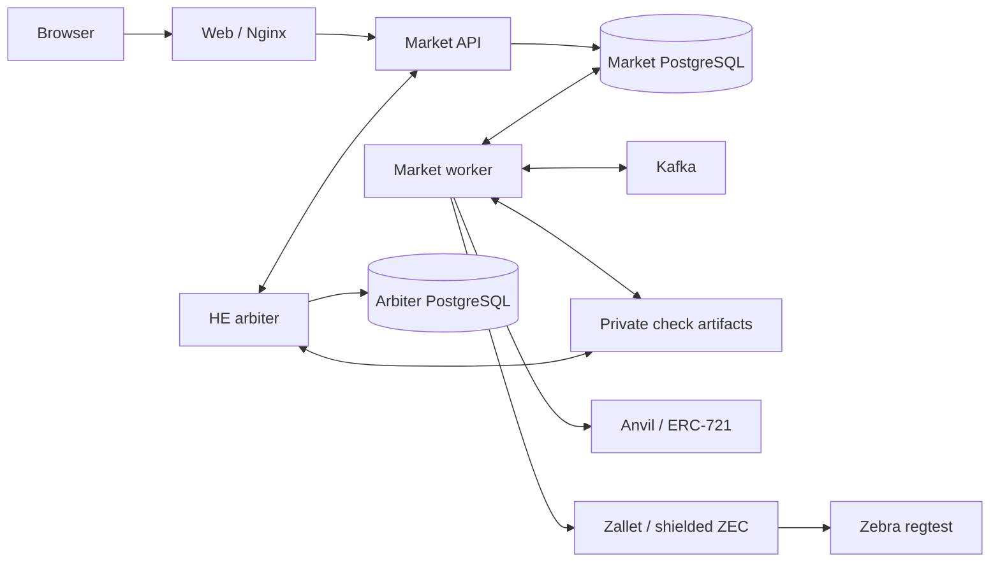

# Runtime architecture

This page describes the executable application and its local-chain deployment. The [cryptographic protocol](cryptographic-protocol.md) also describes stronger proof and key-isolation requirements; those requirements must not be mistaken for guarantees of the development custody profile.

## Services and authority

| Service | Responsibility | Persistent state |
| --- | --- | --- |
| `web` | Built React application and same-origin `/api/` reverse proxy | None; assets are built into the image |
| `api` | Actix HTTP API, Google/session authentication, user authorization and accepted commands | Market PostgreSQL, uploaded media, custody records |
| `worker` | Outbox publication, node-event consumption, approval execution, auction progression and local-chain settlement | Same market database and private files as `api` |
| `db` | Authoritative accounts, assets, auctions, approvals, transaction attempts and outbox | `postgres_data` volume |
| `kafka` | Delivery of asset and node events; duplicate delivery is expected | `kafka_data` volume |
| `arbiter` | Bounded HE computations, signed job results and gateway heartbeat | Own PostgreSQL database and check artifacts; active numeric masks remain in memory |
| `arbiter-db` | Node identity, sequence numbers, job execution and pending result delivery | `arbiter_database` volume |
| `anvil` | Local Ethereum chain and disposable transaction signers | Localnet chain directory |
| `zebra` | Zcash regtest chain and transaction confirmation | Localnet chain directory |
| `zallet` | Custodial Zcash accounts, shielded balances and PCZT operations | Localnet wallet directory |
| `localnet-miner` | Local Zcash block production | Localnet runtime files |
| `localnet-faucet` | Funding and shielding the local faucet balance | Localnet funding state |

`migrate`, `arbiter-migrate` and `kafka-init` are one-shot setup services. A successful exit is expected; they are not missing background workers.

The browser never talks directly to Kafka or the chain RPCs. The arbiter exchanges signed control messages through the API's internal node routes. The market's database remains authoritative for auction membership, consent, timers and settlement state; a delivered event is not by itself proof that an action completed.

## Module boundaries

`tfhe-math` isolates native TFHE types behind abstract values and explicit `MathSession` operations. `private-check` builds numeric transfer, commitments, masked Boolean results and exact decoding on that API. Neither SDK depends on HTTP or PostgreSQL.

`arbiter-protocol` contains service identity and signed control-plane contracts. `check-workflow` contains artifact references and comparison request/response contracts. `apps/arbiter/src/crypto` coordinates the protocol through these SDKs; its runtime handles capacity, leases, delivery and restart behavior.

The market separates `auth`, `assets`, `auctions`, `messages`, `custody`, `nodes`, `chains` and `settlement`. Routes authorize and validate requests; domain modules own transitions; repositories persist them. Chain adapters observe external facts, while settlement binds those facts to the exact approved operation.

## Auction and approval flow

1. The seller creates a draft with an asset, reserve in ZEC and an end time. Amounts accept up to eight decimal places and use exact integer zatoshi internally.
2. Publication fixes the terms and assigned arbiter. In localnet mode, the seller separately approves the prebuilt NFT transfer to that node's registered Ethereum custody address. The listing opens after confirmed custody.
3. Up to three buyers can join. Each gets one immutable bid. Withdrawal does not free an admission slot or allow reentry. The seller cannot bid on their own auction.
4. Independent preparation requests become available as their inputs are ready. Owners can approve at different times. Numeric conversion and result disclosure remain gated until bidding closes; sending a request early does not authorize early decryption.
5. Bidding closes one hour before the end time. The input set and admission order are frozen. The demo-only **Close bidding now** control moves the end to one hour from the click and enters this same closing path.
6. Each participant has one cumulative ten-minute budget across the auction. It starts charging only after bidding closes and only while that participant has ready obligations. Overlapping requests count once; waiting for a service or another participant does not replenish or consume that budget.
7. The arbiter completes the fixed buyer comparisons and reserve checks. A bid qualifies at `bid >= reserve`; pair comparisons use `later > earlier`, preserving earlier admission on a tie. Missing or inconsistent results cannot become a winning bid.
8. Selection advances as soon as the complete required transcript is available. The selected buyer reviews a ZEC invoice, including recipient and fee, before authorizing payment.
9. Confirmed invoice-bound payment enables NFT delivery. The seller approves it explicitly, or their remaining response budget expires and the already accepted publication terms authorize delivery. Completion requires the observed Ethereum transfer.

The displayed end time is not a guarantee that an unavailable chain, failed service or unresolved transaction will finish by that instant. Such waits do not silently become participant fault.

## Visibility and terminal states

Market shows only auctions accepting new bids. When bidding closes, it removes the auction from the public catalog; the seller and admitted buyers retain access through My portfolio. Private pages redirect guests to sign-in with a return destination.

The UI groups ongoing work as Active and distinguishes successful sale from return. **Returned** means the NFT return has actually been confirmed. A no-sale decision while the return is still pending is not a completed refund. A returned NFT does not imply a ZEC refund.

Other buyers cannot read a bid or reserve through the API. The seller and selected buyer can see the agreed price. Account switching clears the previous account's frontend state; private resources still enforce server-side authorization.

## Transaction safety and recovery

Approval is separate from transaction confirmation. An operation retains its reviewed payload, revision, signed transaction bytes and transaction ID before broadcast. An uncertain response is reconciled against the same transaction rather than blindly creating another spend.

The Zcash adapter checks the intended network, recipient account/address, exact amount, invoice memo, canonical block and at least three confirmations. Partial payments may be topped up against the same award. Once payment is authorized, the winner is fixed: the system cannot charge a replacement buyer while that obligation is unresolved. Buyer payment expiry returns the NFT under the accepted terms; it does not reverse partial Zcash transfers.

NFT deposits and withdrawals check the exact collection, token and Ethereum destination. External deposits require a confirmed incoming transfer and current custody; withdrawals remove an NFT from platform ownership only after the outgoing transfer is confirmed.

The outbox and node results are durable and may be redelivered. The market worker resumes accepted owner work from its encrypted records. The arbiter deliberately cannot restore an unfinished comparison's in-memory numeric masks: restarting it interrupts that attempt and the auction follows its interruption/return path. Completed chain operations and signed attempts are retained.

## Deployment and trust boundaries

The supplied Compose topology is a single-host demo. The arbiter shares the API network namespace so its gateway can use loopback HTTP. Zallet's cookie-authenticated RPC is internal to the Docker network. Only the web/API and diagnostic node RPC ports are published, all on host loopback; the HTTPS host proxy exposes the web application.

Multiple provisioned node identities are supported by the control plane, but `docker compose --scale arbiter=...` is not a valid way to create them. Each needs distinct keys, a database, artifacts and listener configuration. Existing custody assignments must retain their original authorized destination.

Development custody gives the platform access to input amounts and user keys. The HE results explicitly carry `assurance: honest_role_mechanics`, `proof_status: unavailable` and `final_audit: not_released`. Strong proof verification, noncustodial user signing, public-network deployment and the full post-settlement Boolean audit are not supplied by this profile. The cross-chain sale is custodial and non-atomic.

See [Operations and deployment](operations.md) for configuration, persistence and service management.
